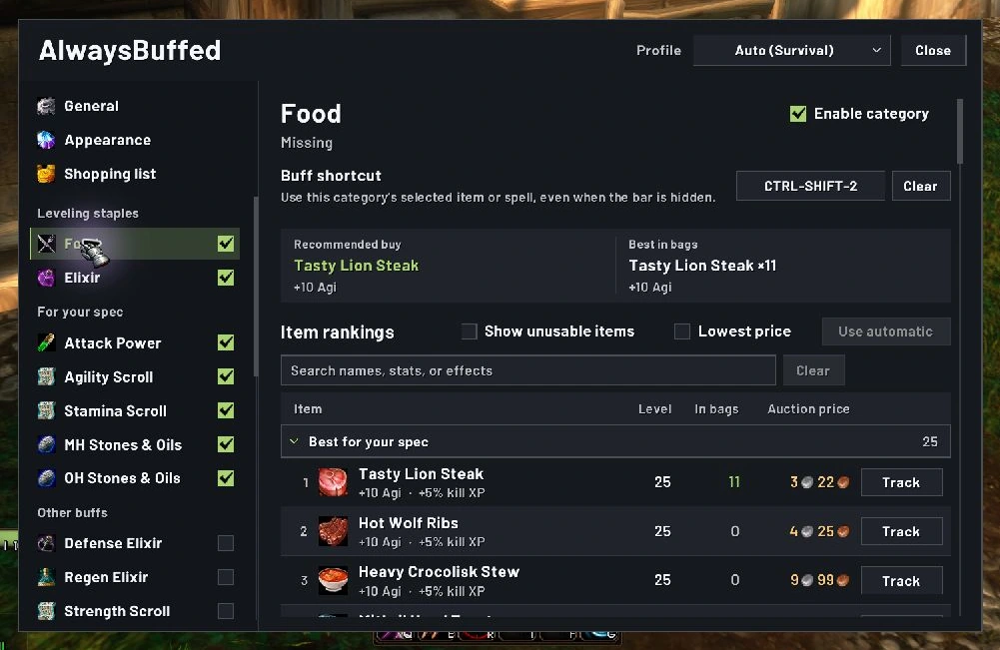
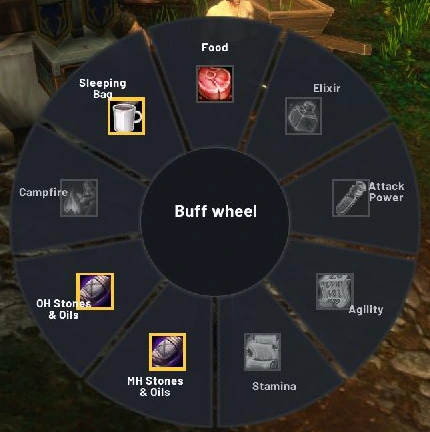

[CurseForge](https://www.curseforge.com/wow/addons/alwaysbuffed) · [Wago](https://addons.wago.io/addons/alwaysbuffed) · [GitHub](https://github.com/SPDUK/AlwaysBuffed)

I built AlwaysBuffed to help me decide what to buy at the auction house while leveling in World of Warcraft: Forever. Take food for example. Tasty Lion Steak, Hot Wolf Ribs and Heavy Crocolisk Stew all give a Survival hunter 10 Agility and 5% extra experience from kills. Which one should I spend my gold on?

In this screenshot the answer is probably none of them. I've already got eleven steaks.



Type `/ab` in game and you get this breakdown for food, elixirs, weapon buffs and a bunch of other things you can use while leveling. The bit I wanted when I left town was much smaller. Give me a button I can click to eat one of those steaks, and let me see how long the buff has left.

## What goes into a steak?

I started with a Lua table of consumables. To build it I followed each item's use effect in the Forever client data through to the spell it triggers. For food that distinction matters. There's the effect you get *while* you're eating, then there's the buff you get to keep when you stand up.

Here's what Tasty Lion Steak looks like in the catalog.

```lua
{
    id = 3728,
    name = "Tasty Lion Steak",
    level = 25,
    stats = { agi = 10, xp = 5 },
    auras = { 1248420 },
    duration = 900,
}
```

I use the item ID to look up how many steaks you're carrying, and the aura ID to check whether the buff is running. The ribs and the stew have their own item IDs but share that same aura, so if you eat the ribs the Food button still lights up.

Each talent build has its own weights for the stats in that table. Agility gets the steak near the top for a Survival hunter. A Holy priest cares more about healing and mana regeneration. There's a nice little edge case in `xp` too. Even food with the wrong stat can be worth eating for the extra experience from kills. Once you hit level 60 the planner stops giving it credit for that.

## What should I buy, and what can I eat right now?

The Food tab has two fields, **Recommended buy** and **Best in bags**. They're both steak in the screenshot, but keeping them separate is what makes the bar work out in the world.

One of my Lua tests gives a level 30 hunter a couple of bowls of soup, a pie and some bread. Steak gives the best bonus that hunter can use, so it goes on the shopping list. Press the Food button, though, and you get soup. Run out of soup and the pie is next. Even the plain bread has a use once all the buff food is gone. I can test that whole sequence by changing a few bag counts without having to log in and eat my way through it. [The planner test on GitHub](https://github.com/SPDUK/AlwaysBuffed/blob/v1.0.4/tests/planner.lua#L16-L47)

Prices fit on the shopping side of that split. If you use Auctionator, run a full scan at the auction house and tick **Lowest price** in AlwaysBuffed. It'll suggest the cheapest useful food you can eat that has a cached price. If there's no price data it falls back to the usual ranking. Either way I can keep eating the good stuff I've already paid for.

## Getting it down to one button

The buff bar, keybindings and radial wheel all use the same bag choice. I can bind Food directly, or hold the wheel shortcut, move towards Food and release to eat. Letting go in the middle cancels. The gold outlines in the screenshot are the buffs that are already up, including the stones on each weapon.



Weapons were where one button per category got a bit awkward. A rogue can have Instant Poison on one dagger and Deadly Poison on the other. Refreshing one tells you nothing about how long the other has left, so I gave each hand its own choice and timer. WoW also restricts changes to action buttons during combat. I set up the bar's actions before combat and refresh them afterwards. You can still fold the bar out of the way mid-fight.

If you want to try it, grab the ZIP ending in `-forever.zip`, put the `AlwaysBuffed` folder in `_forever_/Interface/AddOns/`, then enable it and type `/ab`. Open Food first. You might already have dinner sorted. [Download AlwaysBuffed](https://github.com/SPDUK/AlwaysBuffed/releases/latest) · [Code on GitHub](https://github.com/SPDUK/AlwaysBuffed)
