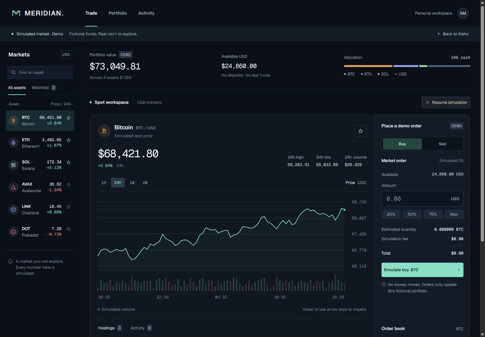
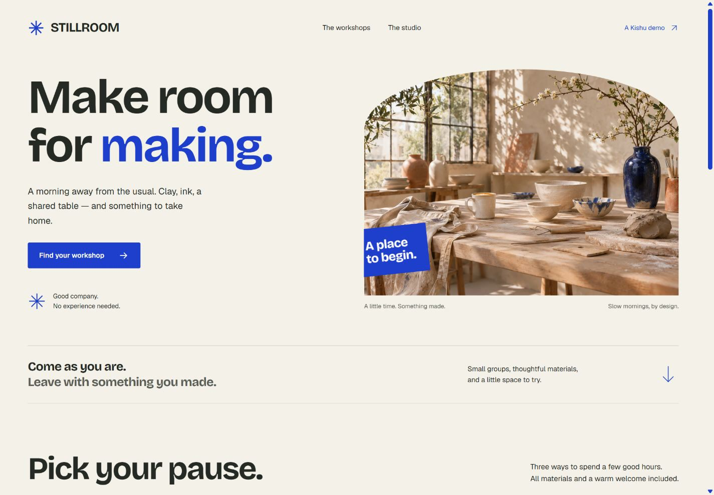

## A shared way of working for my AI coding agents

[View Site](https://spduk.github.io/kishu-stack/) | [Code on Github](https://github.com/SPDUK/kishu-stack)

---

Tools Used: **[Python](https://www.python.org/), [Markdown](https://daringfireball.net/projects/markdown/), [JavaScript](https://developer.mozilla.org/en-US/docs/Web/JavaScript)**

---

## What it does

Kishu is a plugin I put together to give my coding agents a consistent way to work. It brings task routing, design guidance and the way I want progress explained into one mode, with packaging for Codex, Cursor and Claude Code.

The idea is to spend less time managing the agent. I want to describe the result, have it work out which guidance is useful, and get something back that I can actually inspect.

A small change should stay small. A tricky bug might need more investigation, and a new interface needs attention to how it looks and feels. Kishu's instructions are set up to make that distinction, including bringing in other agents when there's a useful reason to.

## How it works

Most of the working mode is Markdown. The entrypoint loads a router, which picks the relevant playbook and references for the request. It doesn't need to read every guide just to change a line of copy.

Kishu brings together three open-source projects:

- [pstack](https://github.com/cursor/plugins/tree/main/pstack), by Lauren Tan, provides the engineering workflows and routing foundations.
- [Impeccable](https://github.com/pbakaus/impeccable), by Paul Bakaus, provides the design guidance behind Kishu's design taste engine.
- [i-have-adhd](https://github.com/ayghri/i-have-adhd), by Ayoub G., provides guidance adapted into clearer progress updates and answers that put the result first.

My part is the combination, the working preferences and the packaging around them. The original credits and licences stay in the bundle.

A Python script builds the plugin from pinned upstream versions and Kishu's own source and overrides. It also handles installation, updates and exporting a standalone skill for other compatible tools. Keeping the generated bundle separate means I can update the source and rebuild it without manually maintaining several copies.

## Keeping the useful parts

Model preferences live outside the generated plugin, so updating Kishu doesn't wipe them. I can choose different models for implementation and review, or let delegated work use the current model. Those choices apply to delegated roles; they don't change the model selected in the main chat.

The other part I care about is checking the result. Kishu asks for relevant tests when behaviour changes, and a look at the rendered page for visual work. It should also say when something couldn't be checked.

These are instructions for an agent, so the actual tests and the tools' permissions still matter. The useful bit is making those expectations part of the normal workflow instead of repeating them in every prompt.

## Built with Kishu

The project includes its own website and three interactive examples. They're different enough to show what the same workflow can produce without making every site look the same.

**Veldrift** is a fictional MMO website, with generated fantasy landscapes and an explorer for switching between destinations.

[Explore Veldrift](https://spduk.github.io/kishu-stack/mmo/)

**Meridian** is a trading dashboard with charts, simulated moving prices and a demo order flow. It gives the workflow a denser interface to deal with, where the numbers and controls need to be easy to follow.

[Try Meridian](https://spduk.github.io/kishu-stack/meridian/)

**Stillroom** is a creative studio site with generated workshop imagery, session selection and a local booking flow.

[Visit Stillroom](https://spduk.github.io/kishu-stack/stillroom/)

All three are working demos for fictional products. The market data is simulated, and no trades, payments or reservations are sent.

The site also has a [build story](https://spduk.github.io/kishu-stack/case-studies/mmo.html) with more detail on the process. You can find the plugin, installation instructions and the demo source on [GitHub](https://github.com/SPDUK/kishu-stack).
